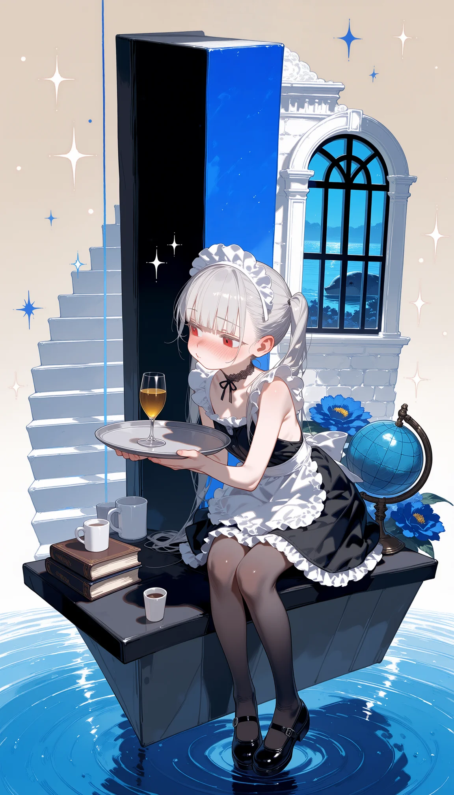

# 02 · 立体构成主义海报



> **出图信息（读 PNG 元数据实查）**：底模 `anima\anima-turbo-v1.1-int8convrot.safetensors`（＋ `anima-turbo-lora-v0.1`）；
> [19] 分辨率 `768 × 1344`，成图 **1152 × 2016**；KSampler `euler_ancestral / beta`、steps 8、cfg 1.0；
> 激活 LoRA 链 `sky02Lightv3 1.00` ＋ `anima-base-1-masterpiece-v51 1.00` ＋ `anima_context_detailer_base10 0.60`
> ＋ `far off in the morning haze… 0.80` ＋ `Anima_in_real_update_v2_epoch_20 1.20` ＋ `mixed_styles_anima-base1_v5 1.00`
> （`gpt-image-2_anima-base1_v1-1` 未激活）。
> 提示词来源：本次会话手写，长度见「③ 完整示例」。

---

## ① 风格定位

**构成主义（Constructivism）＋ 二次元版式海报**，落成画面是一句话：

> **硬边几何色块构成 ＋ 精致二次元人物 ＋ 浅空间舞台 ＋ 极窄冷色盘。**

- **适用画面**：竖版海报／立绘式宣传图。人物居中，背景是纸面般的几何色块构成，底部常带水面与倒影。
- **谱系**：构成主义 × 风格派／新造型主义（矩形分割）× 包豪斯（几何＋字体当图形）× 瑞士国际主义平面（网格、硬边、无装饰）；人物画法为日系赛璐珞。
- **注意**：这是**浅空间舞台**，不是立体写实场景；画成照片感就掉风格。
- **一句话判据**：**像舞台模型，不像照片。**

**为什么它出彩（八条骨架，复刻时必须保留）**

1. **色盘极窄**——米白／黑／炭灰／钴蓝／淡蓝，五色以内（窄色盘即高级感）。
2. **硬边平涂**——几乎无渐变与写实影调，色块靠**明度差直接切开**，带印刷感。
3. **浅空间舞台**——纵深来自「**阶梯 ＋ 平台 ＋ 水面透视**」三件套，不靠阴影与空气感。
4. **人物嵌入结构**——人物**坐在平台上、被色块切割**，不是站在背景前面。
5. **斜线动势**——只留**一条主导斜线**贯穿画面（本例＝银灰斜带）。
6. **大面积米白留白**——构成主义的"纸面"底，给呼吸感。
7. **道具同调**——静物同一色系、同一调性（本例＝地球仪／书堆／马克杯／白盒／蓝花簇）。
8. **人物有戏**——姿态与表情带叙事（弯腰端盘、脸红别脸不情愿），不是站桩。

## ② 提示词结构/要点

整体分六层写，与 `workflows/anima/prompting.md` 的六层骨架一致：

| 层 | 写什么 | 本例对应 |
|---|---|---|
| ① 概括 | 一句：风格 ＋ 谁在做什么 | `Constructivist poster of a cute maid carrying a tray of drinks, sitting inside a composition of hard-edged geometric blocks.` |
| ② 人物 | 人数 tag ＋ 外观 ＋ **服装逐件** | `1girl, solo, cute maid, snow-white long hair, twin tails, …, black pantyhose, mary janes.` |
| ③ 动作 | 一句进行中的动作，写清手与物的关系 | `She bends forward at the waist, kneeling on a flat black platform, carrying a round silver tray in both hands with her fingers curled under the rim, …` |
| ④ 环境 | **结构元素逐件点名**（4–6 件）＋ 底部水面 | `a tall black vertical panel, a blue diagonal band cutting from the upper right toward the middle left, …` |
| ⑤ 机位构图 | 机位 ＋ 画幅 ＋ 人物位置 | `Low angle, full body, vertical composition, she sits at the center.` |
| ⑥ 风格 | 骨架词（恒定层） | `hard-edged flat color blocks, limited cold palette of blue, black and ivory, diagonal cutting lines, constructivist poster design, crisp clean anime lineart, cel shading, high contrast.` |

### 恒定层（改了立刻掉风格，照抄不动）

```
hard-edged flat color blocks
limited cold palette of black, charcoal, cobalt blue and ivory
diagonal cutting lines
constructivist poster design
crisp clean anime lineart, cel shading, high contrast
```
另加两条结构恒定：**底部恒为透视水面**（`blue water surface in perspective, concentric ripples, soft reflections`）；**点缀恒为星芒细线**（`white four-point sparkles, thin orbit lines carrying tiny round nodes`）。

### 写法五要点（决定成败）

1. **结构元素逐件点名**——不要写"几何背景"这类笼统词，笼统词只会换来一块平脸。
2. **浅空间靠三件套建立**——`white stair steps` ＋ `on a flat platform` ＋ 底部 `water surface in perspective`；三者缺一，画面塌成平面。
3. **主导斜线只留一条**——斜线多了画面就乱。
4. **人物必须嵌进去**——写 `kneeling on a flat black platform` / `standing on a broad flat platform at the center`，不要只写 `standing`。
5. **道具宁少勿杂**，且同色系；混进不同调性的物件（霓虹、机械零件）立刻破风格。

## ③ 完整示例

anima 快速流原文，比例 9:16（`--w 768 --h 1344`），画风 mix（`gpt-image-2` 关、`mixed_styles_anima-base1_v5` 开 1.00）。提示词 **1224 字符**：

```text
Constructivist poster of a cute maid carrying a tray of drinks, sitting inside a composition of hard-edged geometric blocks.

1girl, solo, cute maid, snow-white long hair, twin tails, bangs, red eyes, heart-shaped face, thin lips, fair skin, heavy blush, black backless maid dress, white apron, frilly trim, lace maid headdress, black lace choker, black pantyhose, mary janes.

She bends forward at the waist, kneeling on a flat black platform, carrying a round silver tray in both hands with her fingers curled under the rim, a glass of wine standing on the tray. Her face turns away with a heavy embarrassed blush, eyes looking aside, lips pursed in a reluctant pout.

Behind and around her, a constructivist composition on an ivory paper background, built from large hard-edged blocks in black, navy, cobalt blue and white: a tall black vertical panel, a blue diagonal band cutting from the upper right toward the middle left, a black triangular wedge low on the left, a row of white stair steps with thin black edge lines, a column of black-and-white stripes, a dark arched window holding a blue sea view, a cobalt circle with a whale silhouette beside it, thin blue vertical lines carrying tiny round nodes.

Props around the lower area: a globe on a black stand, a stack of three books, a white mug, a small white box, and a cluster of blue flowers.

The bottom of the image is a blue water surface with concentric ripples and soft reflections of her feet, the books and the globe. White four-point sparkles and thin orbit lines scatter across the upper areas.

Low angle, full body, vertical composition, she sits at the center.

hard-edged flat color blocks, limited cold palette of blue, black and ivory, diagonal cutting lines, constructivist poster design, crisp clean anime lineart, cel shading, high contrast.
```

## ④ 复用要点

**复刻 ＝ 换内容，不换骨架。** 恒定层与「三件套」不动，只替换下列槽位：

| 槽位 | 写法 | 可替换为 |
|---|---|---|
| 人物 | `1girl, solo, <角色串或手写外观>，**服装必须显式逐件写**` | 任意角色（不写服装容易画成裸体） |
| 姿态＋叙事 | 一句动作句 `She <动作> at the center` | 跪坐端盘／站在平台边／倚柱回头／坐在台阶上／抱膝 |
| 结构元素（挑 4–6 件，逐件点名） | 硬边几何块清单 | `white stair steps with thin black edge lines` / `tall charcoal panel` / `silver diagonal band` / `pale blue rectangle` / `dark arched window holding a sea view` / `large flat grey circle` / `thin vertical lines carrying tiny round nodes` |
| 道具（同调 3–5 件） | 同一色系静物 | 地球仪／书堆／马克杯／白盒／蓝花簇／沙漏／纸飞机／信封 |
| 主色 | 换冷色系 | 钴蓝＋米白（本例）／青绿＋炭黑／洋红＋米白（波西向） |

### 实测易错点（逐条记录）

| 症状 | 原因 | 修法 |
|---|---|---|
| 滑向"3D 写实场景"，舞台模型感没了 | 阶梯／倒影／透视写过头 | 强化 `hard-edged flat color blocks` 与 `limited cold palette`，景深收在"模型布景"级 |
| 背景像一整块平面、没有块感 | 只写"几何色块"，没写块与块的关系 | 改成"多块矩形**相互咬合叠压**、逐块镶边、另给贯通竖/横/斜分割线" |
| 托盘／道具悬空 | 手与物的托举关系没写 | 写死 `fingers curled under the rim, thumbs on top` |
| 人物没穿衣服／服装丢失 | 服装没显式写，或只靠角色串 | 服装逐件写，如 `wearing her school uniform, JK uniform, white shirt, dark blazer, plaid skirt, thighhighs` |
| 出现无主的肢体（如顶部多出一双腿） | 空间层次多、元素杂时高发 | 重出；减少无关元素，并写清 `1girl, solo` |
| 元素只出来一半 | 元素堆太多 | 控制在 3–5 件，逐件给明确名词 |

---

*来源：2026-10-16 会话手写并实出成图；样图为该提示词的原始 PNG。*
