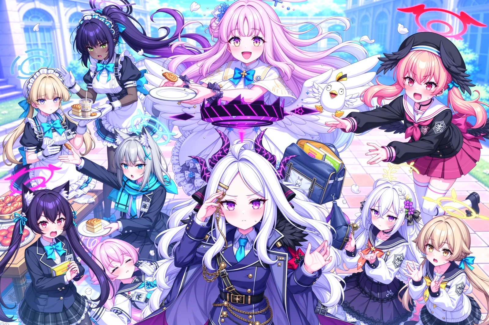

# 01 · 多人图提示词（MOSS Scene JSON · bbox 定位布局）



**这是什么**：OpenMOSS 官方案例「Ten Blue Archive students in one chaotic group shot」的 Scene JSON 原文与用法拆解。**本库只收这一份多人图案例，不收集官方其它案例。**
本库的第一份案例，价值不在画面本身，而在**它演示了「十个人物靠 bbox 定位框各占其位、不融成一团」的写法**。

来源：`http<local_path>`（官方案例集：`http<local_path>`）
归档日期：2026-10-20 ｜ 本机复刻实测：`--ratio "3:2 (Photo)" --megapixels 2.0 --no-upscale` → **1776×1184**，十人全部可分辨、无融合。

## ① 官方参数（本机不同档，见下节）

| 项 | 官方 | 本机实际 |
|---|---|---|
| 模型 | MOSS-Image-Base | moss_image_base_int8_convrot ＋ 4_steps_v2 加速 LoRA（12 步档） |
| 尺寸 | 1776 × 1184 | 1776 × 1184（成图记录；现档同比例 2.0MP → **1728×1152**，宽高对齐 16） |
| 步数 | **50** | **12**（旧档 8） |
| CFG | **5** | **1.0**（旧档 3.5；2026-10-26 实测 1.0 画质更高） |
| Shift | 5 | — |
| Sampler | Euler | er_sde |
| Skip layer (negative) | 22 | — |
| Seed | **3072627948** | 同值（但跨管线不会复现同一张，官方明说） |
| 提示词 | Scene JSON，8,451 字符 | 原文照投，9,406 字符含格式 |

## ② 提示词结构（这份 JSON 怎么组织的）

四个顶层键，缺一不可：

| 键 | 作用 | 本例要点 |
|---|---|---|
| `scene_type` | 一句话定题材与叙事语气 | `chaotic anime ensemble action comedy` |
| `gen_brief` | **整幅画面的总述**（本例 3,045 字符）：谁在哪个方位、谁是视觉锚点、谁和谁重叠、哪些部位可以遮、哪些不能遮、动势从哪到哪、分层怎么排 | 关键句：`not a grid or three horizontal rows`；`Overlap shoulders and lower torsos, never faces`；`stagger head heights and keep each halo close to its owner` |
| `elements` | **每个角色一条**：`type` / `salience` / `identity` / `bbox` | `identity` 写「角色名 (Blue Archive) + 位置关系 + 服装 + 动作 + 表情」，`bbox` 定框 |
| `bbox_coord_space` | 坐标空间 | `abs_centralized`（以画面中心为原点的绝对坐标） |

## ③ 十个角色与它们的框

| # | 角色 | bbox `[x1,y1,x2,y2]` | 位置与职能 |
|---|---|---|---|
| 1 | Asuma Toki | `[-395, -867, 254, -393]` | |
| 2 | Kakudate Karin | `[-564, -584, 99, -117]` | |
| 3 | Sorasaki Hina | `[-78, -231, 592, 251]` | |
| 4 | Misono Mika | `[-592, -231, 177, 364]` | |
| 5 | Shimoe Koharu | `[-423, 264, 374, 888]` | |
| 6 | Kuromi Serika | `[70, -888, 592, -463]` | |
| 7 | Sunaookami Shiroko | `[-92, -606, 473, -131]` | |
| 8 | Takanashi Hoshino | `[274, -563, 592, -96]` | |
| 9 | Ajitani Hifumi | `[169, 497, 592, 888]` | |
| 10 | Shirasu Azusa | `[56, 165, 592, 647]` | |

（bbox 数值见下方 JSON 原文；坐标空间 `abs_centralized`，x 范围约 ±592、y 约 ±888。）

## ④ 复用要点（换角色 / 换场景 / 换题材）

1. **骨架照搬，内容全换**：保住四键结构、`gen_brief` 里那套「谁在哪、谁遮谁、脸不许遮、层级错落」的写法，只替换角色名、`identity` 描述与 `bbox`。
2. **`bbox` 不是装饰，是防糊的核心**。删掉它十个人就会融成一团——官方案例说明原文：*each given a box and a short identity line... the boxes keep them from merging into each other*。
3. **`identity` 一行要写四件事**：① 角色名＋作品（模型认得的名字）② 与相邻角色的方位关系（"behind X and above-right of Y"）③ 服装/外观 ④ 正在做的动作与表情。只写名字模型会给通用形象。
4. **`gen_brief` 必须显式否定格状构图**：`not a grid or three horizontal rows`——不写这句，十人必然退回三排站。
5. **遮挡规则写在总述里**：可以遮肩与下半身，**绝不遮脸**（`Overlap shoulders and lower torsos, never faces`）。
6. **换人数时同步改 `gen_brief` 的空间描述**：加人不是加一条 element 就完事，要给新角色在总述里分好位置，并把被挤动的邻居方位一起改写。
7. **本机档位偏快**：**8 步 / cfg 1.0 / lodestones-8-steps-dmd2 加速 LoRA**（旧档是 12 步 / cfg 3.5）跑复杂布局，脸和人物分离没问题，但**手指与道具的持有关系仍会含糊**。要更细就得按官方档跑（Base、Euler、50 步、CFG 5、shift 5、skip layer 22），代价是慢数倍。

## ⑤ 提示词原文（Scene JSON，逐字未改）

> 可直接用：`python workflows/moss/moss_api.py --prompt-file <本文件里这段 JSON 存成 .json> --ratio "3:2 (Photo)" --megapixels 2.0 --no-upscale`

```json
{
  "scene_type": "chaotic anime ensemble action comedy",
  "gen_brief": "A lively Blue Archive campus group photo collapsing into a harmless slapstick disaster, featuring exactly ten distinct named students from the elements, each appearing once. An asymmetric arch-shaped ensemble composition in one continuous sunlit courtyard, viewed slightly from above, not a grid or three horizontal rows. Hina stands closest to the viewer at the lower center as the main visual anchor. Behind her, Karin at upper-left, Mika at upper-center and Koharu at upper-right form an uneven arc of large, clearly separated faces. Mika and Koharu occupy the expanded upper-center and upper-right areas so there are no vacant character slots. Toki leans inward from the left edge beneath Karin; Shiroko reaches into their snack rescue from the left middle-ground. Serika anchors the lower-left corner, while sleeping Hoshino forms a low reclining diagonal between Serika and Hina, partially occluding Shiroko's lower body without covering her face. Koharu leans inward from the upper-right, with Azusa at the lower inner-right and Hifumi at the lower outer-right, forming a compact triangular toy-rescue interaction. Hifumi is in front of Koharu's lower torso. Keep Hina's face below Mika's and between the left and right action groups, with Hina's shoulders in front of their inner edges. Overlap shoulders and lower torsos, never faces; stagger head heights and keep each halo close to its owner. Heads and torsos fill their boxes rather than floating inside unused padding. Naturally crop the nearest lower bodies at the bottom and sides. The courtyard remains continuous, with small glimpses of architecture, steps, sky and blanket between the crowd, no dividing aisles or portrait slots. A curving gust carries blank napkins and papers from the tipping snack tray at left, above Mika's reaching hands, toward one small airborne Peroro plush at right. Pastries and paper trails pass around faces, not across them. Toki and Karin catch snacks, Shiroko reaches for a pastry, and Serika protests. Hina wearily asks everyone to calm down while Mika laughs behind her. Hoshino sleeps through everything. Koharu reaches down-left for the toy above Azusa's open schoolbag while Hifumi watches anxiously. Use varied eyelines, diagonal poses and calm-versus-panicked reactions rather than identical smiles. Exactly ten students, no spectators, duplicates or extra limbs. The single Peroro plush is an inanimate toy. Friendly nonsexual school comedy, no weapons, injuries, dangerous falls or upskirt angles. Crisp expressive anime linework, refined cel shading, pastel colors, warm upper-left sunlight and consistent blue ambient shadows. All ten wear their recognizable default clothing and halos, modified to omit every chest badge, school badge pin, name tag, ID card, badge holder and ID lanyard, even when these belong to the default outfit. No replacement badge-shaped chest patches or chest insignia. Preserve other clothing, neckties, ribbons and scarves. No added captions, speech bubbles, floating labels, watermarks or unrelated logos.",
  "elements": [
    {
      "type": "panel",
      "salience": "background",
      "identity": "Sunlit Kivotos courtyard framed behind the ten-student ensemble. Small upper-corner glimpses of cyan sky and white campus arches, shallow stone steps, a cropped snack table at the left, and a picnic blanket at the bottom. A few windblown blank papers, napkins, petals, and pastries arc through open gaps above shoulders, never covering faces. No extra spectators, signage, or damage",
      "bbox": [
        -592,
        -888,
        592,
        888
      ]
    },
    {
      "type": "obj",
      "salience": "secondary",
      "identity": "Asuma Toki (Blue Archive), left edge at intermediate depth, lower and farther left than Karin, behind Serika; in her default maid uniform and signature halo, without chest badges or ID accessories, no exoskeleton. Leaning diagonally inward toward Karin, one hand balancing a tipping snack tray and the other catching a cup, deadpan calm expression",
      "bbox": [
        -395,
        -867,
        254,
        -393
      ]
    },
    {
      "type": "obj",
      "salience": "secondary",
      "identity": "Kakudate Karin (Blue Archive), upper-left inner arc, behind Shiroko and above-right of Toki; in her default maid uniform and signature halo, without chest badges or ID accessories. Leaning down-left toward Toki's tipping tray with an empty plate held in both hands to catch a pastry, focused startled expression, hair flowing with her motion",
      "bbox": [
        -564,
        -584,
        99,
        -117
      ]
    },
    {
      "type": "obj",
      "salience": "primary",
      "identity": "Sorasaki Hina (Blue Archive), dominant lower-center foreground anchor, directly in front of Mika, between Shiroko and Azusa; in her default Prefect Team uniform and signature halo, without chest badges or ID accessories. Large readable head and torso, lower body cropped at the bottom. Turning slightly toward the left snack scramble with a weary exasperated expression, one palm raised to ask everyone to calm down and the other hand touching her temple without covering her face",
      "bbox": [
        -78,
        -231,
        592,
        251
      ]
    },
    {
      "type": "obj",
      "salience": "primary",
      "identity": "Misono Mika (Blue Archive), broad upper-center rear arc between Karin and Koharu, behind Hina with her face clearly above Hina's halo; in her default Trinity uniform and signature halo, without chest badges or ID accessories. Large readable head and torso. Laughing in delighted surprise while making a tiny safe hop, hands reaching diagonally upward toward fluttering napkins, wings slightly lifted inside her action envelope",
      "bbox": [
        -592,
        -231,
        177,
        364
      ]
    },
    {
      "type": "obj",
      "salience": "secondary",
      "identity": "Shimoe Koharu (Blue Archive), upper-right end of the arc beside Mika, behind Hifumi and above-right of Azusa; pink eyes with cat-like vertical slit pupils (<|><|>), in her default uniform and signature halo, without chest badges or ID accessories. Large readable head and torso, leaning diagonally down-left with a flustered blushing expression, both hands reaching urgently toward the single small airborne Peroro plush just above Azusa's raised open schoolbag",
      "bbox": [
        -423,
        264,
        374,
        888
      ]
    },
    {
      "type": "obj",
      "salience": "secondary",
      "identity": "Kuromi Serika (Blue Archive), lower-left foreground corner, in front of Toki and left of Shiroko; red eyes, in her default Abydos uniform and signature halo, without chest badges or ID accessories. Half-rising from the picnic blanket and turning up-right toward Shiroko with an indignant comic shout, clutching a snack bag to her chest, ears alert and twin tails swinging",
      "bbox": [
        70,
        -888,
        592,
        -463
      ]
    },
    {
      "type": "obj",
      "salience": "primary",
      "identity": "Sunaookami Shiroko (Blue Archive), left middle-ground below Karin, behind Hoshino and left of foreground Hina; in her default Abydos uniform with her necktie, striped scarf and signature halo, without any chest badge, school badge pin, name tag, ID card or ID lanyard. Leaning eagerly up-left from a crouch toward the snack tray, one arm reaching for a falling pastry while the other hand holds her paper plate, intensely focused deadpan face, scarf streaming inward",
      "bbox": [
        -92,
        -606,
        473,
        -131
      ]
    },
    {
      "type": "obj",
      "salience": "primary",
      "identity": "Takanashi Hoshino (Blue Archive), very low foreground left of Hina and right of Serika, in front of Shiroko's lower torso; eyes sleepily closed, in her default Abydos uniform and signature halo, without chest badges or ID accessories. Napping undisturbed in a diagonally reclining seated pose with her cheek on a soft picnic cushion, a paper napkin resting on her shoulder, face fully visible, lower body naturally cropped",
      "bbox": [
        274,
        -563,
        592,
        -96
      ]
    },
    {
      "type": "obj",
      "salience": "secondary",
      "identity": "Ajitani Hifumi (Blue Archive), lower-right outer corner in front of Koharu and to Azusa's right; in her default Trinity uniform and signature halo, without chest badges or ID accessories. Close cropped seated pose, looking anxiously up-left toward her single wind-tossed Peroro plush with both empty hands below her chin, worried comic expression; no second plush",
      "bbox": [
        169,
        497,
        592,
        888
      ]
    },
    {
      "type": "obj",
      "salience": "secondary",
      "identity": "Shirasu Azusa (Blue Archive), inner-right foreground between Hina and Hifumi, below-left of Koharu; purple eyes, in her default Trinity uniform and signature halo, without chest badges or ID accessories. Crouching with intense concentration, holding an open schoolbag up-right beneath the Peroro plush's flight path like a serious mission, face turned upward and unobscured",
      "bbox": [
        56,
        165,
        592,
        647
      ]
    }
  ],
  "bbox_coord_space": "abs_centralized"
}
```
