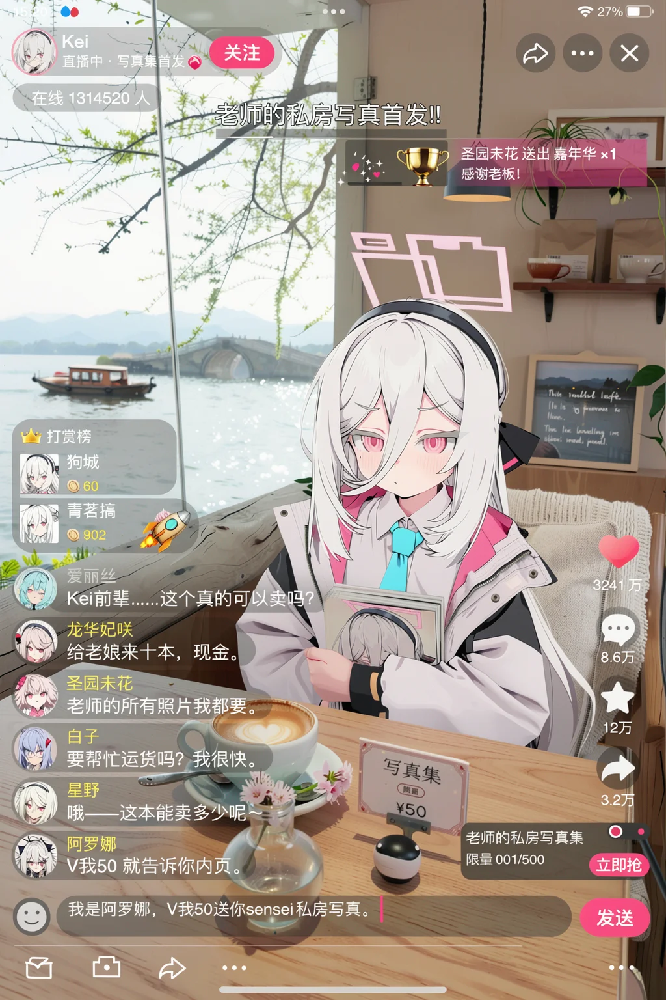

# 02 · 直播 UI 界面（竖屏直播切片 · 用 Scene JSON 一层层叠 UI）



**这是什么**：一张**竖屏直播界面**的完整合成图——人物只是中间一层，上面叠了平台顶栏、礼物横幅、打赏榜、六条滚动弹幕、右侧互动栏、商品卡、底部输入栏。全部由 MOSS 的 Scene JSON 用 bbox 一层层叠出来，**没有二次 PS 拼贴**。
它是本库第二份案例，价值在于演示「**界面类画面怎么拆成可定位的元素**」——这和多人图是同一套机制：一个元素一个框。

归档日期：2026-10-25 ｜ 本机实测：**1024×1536**，13 个元素，一次出图。

## ① 生成参数

| 项 | 值 |
|---|---|
| 底模 | `moss_image_base_int8_convrot.safetensors` |
| 文本编码器 | `qwen3.5_9b_int8_convrot.safetensors` |
| VAE | `flux2-vae.safetensors` |
| 加速 LoRA | `lodestones-8-steps-dmd2-lora`（strength 1） |
| 步数 / CFG | **8 / 1.0** |
| 采样器 / 调度 | `er_sde` / `simple` |
| 尺寸 | **1024 × 1536**（竖屏 2:3，模拟手机直播） |
| Seed | `923959868604654` |
| 画质 LoRA | `moss_context_detailer_…rank2` 0.60 ＋ `KOOK-MOSS-SFT-观澜` 1.00 ＋ `LP Flat-moss-v2` 1.00 |
| 提示词 | Scene JSON，**10,183 字符**，13 个 elements |

> LoRA 下载地址见 `workflows/moss/节点与lora下载地址.md`。**LP Flat-moss-v2 是这套界面的关键**——它把画面压成扁平大色块，UI 才不糊。

## ② 结构：13 个元素怎么分工

| 层 | 元素 | type | bbox 作用 |
|---|---|---|---|
| 底 | 整块直播画面 | panel/background | 铺满全屏（±592 × ±1052），定"这是一块竖屏" |
| 景 | 左侧落地窗 + 湖景 | obj/secondary | 占左上大半，给画面留空气 |
| 景 | 右侧咖啡馆内景 | obj/secondary | 暖木墙、吊灯、杯子货架 |
| 中 | 窗边沙发座 + 靠垫 | obj/primary | 人物的承托面 |
| 中 | 桌面摆件 | obj/primary | 拿铁、写真集立牌、小票、花瓶 |
| **主** | **主播（Tendou Kei）** | obj/primary | 画面正中偏下，半身入镜 |
| UI | 顶部信息栏 | obj/primary | 头像、昵称、关注、在线人数、静音/分享/关闭 |
| UI | 礼物感谢横幅 | obj/secondary | 右上滑入的深色圆角条 |
| UI | 打赏榜 | obj/secondary | 左边缘竖条，两条记录 |
| UI | 弹幕区 | obj/primary | 左下 6 行同构评论 |
| UI | 右侧互动栏 | obj/secondary | 点赞/评论/收藏/转发/分享 5 个圆钮 |
| UI | 商品卡 | obj/secondary | 右下「写真集 限量 001/500」+ 立即抢 |
| UI | 底部输入栏 | obj/primary | 输入框 + 表情/相册/分享/更多 |

## ③ 为什么这套写法成立（可迁移的部分）

1. **UI 不是"画个界面"，是"每个控件一个身份描述"**。每个 UI 元素在 `identity` 里写清：形状、圆角、半透明深色底、白字、字号、排列顺序，甚至把中文文案原文写进去（`"爱丽丝"`、`"给老娘来十本，现金。"`）。不写控件细节，模型会自己发明一套界面。
2. **必须有一条 panel/background 铺满全屏**，否则模型把 UI 当"贴在墙上的海报"，边缘会露出底图。
3. **弹幕用"同构重复"描述**：六行写成"每行都是小圆头像+彩色昵称+白色文字"再逐行给原文，比"一堆评论"可控得多——这是本案例最值得抄的一句。
4. **人物与 UI 分层占位**：人物框只到腰，UI 框各自贴边，互不重叠；重叠的只有顶栏压在头发上这种"本来就会挡"的关系。
5. **中文文案直接给原文**：MOSS 的中文字形是强项，把要出现的字逐条列在对应元素里，比事后 PS 便宜一个数量级。
6. **竖屏靠 bbox 比例定**：1024×1536 下坐标 ±592/±1052，横竖比接近 9:16，UI 才有手机味。

## ④ 换皮复刻清单（换平台 / 换题材）

1. 保住四键骨架：`scene_type` / `gen_brief` / `elements` / `bbox_coord_space`。
2. **先摆 UI 骨架，再填人**：底 panel → 顶栏 → 侧栏 → 底栏 → 中部内容 → 人物。
3. 换平台就换控件清单（B 站是投币/弹幕飘屏，抖音是点赞/礼物，淘宝是购物车/价格条）；**控件数量控制在 5–8 个**，再多必糊。
4. 文案全部从 `identity` 里换，一次只改字，不改结构。
5. 想要"截图感"就把 `gen_brief` 里的手机截图比例、状态栏、圆角写死。
6. 出图后如果小字糊，优先加 LP Flat 类扁平 LoRA 或提到 3:4 大图，而不是加步数。

## ⑤ 提示词原文（Scene JSON，逐字未改）

```json
{
  "scene_type": "vertical mobile livestream UI mockup, a bright spring cafe by West Lake with an anime girl host seated against cushions",
  "gen_brief": "A vertical phone-screen livestream interface captured as one flat UI screenshot laid over a fully painted live set, not a poster and not a sticker collage. The room is a sunlit cafe on the shore of West Lake on a mild spring day, airy and high-key: a tall floor-to-ceiling window wraps the left and upper part of the feed with slim dark mullions, spring sunlight pouring in at a low angle so the whole frame carries a clean luminous haze, soft lens bloom and floating dust motes. Outside the glass, West Lake spreads out in soft focus: willow branches hanging in fresh yellow-green leaves with catkins drifting, water glittering in broken highlights, a distant arched bridge and a slow pleasure boat, faint blue hills, cherry blossom petals blowing past the pane. Inside, warm light wood panelling, a hanging pendant lamp, shelves of cups and coffee bags, a green plant, a chalkboard menu with blurred chalk writing. The host sits against a plump cream linen cushion in a window-side booth, a second cushion behind her shoulder, a soft knitted throw over the seat back. Her upper body from the head to the waist is above a light oak table, where a latte with a heart in the foam, a stack of glossy photobooks with her own portrait on the covers, a fanned pile of banknotes, a small vase of cherry blossoms, a folded price card, a small round plush and a small softbox on a stand are arranged. Clean UI layers sit above everything: white Chinese sans-serif on translucent light-dark scrims, hot-pink accents, rounded cards; every comment row starts with a small circular portrait in a thin ring. UI never covers her eyes or the draft text. Backlit spring sun rims her hair and shoulder, bounce light fills her face, shadows stay open and cool-tinted. No rain, no night, no flat void behind her, no photorealistic skin.",
  "elements": [
    {
      "type": "panel",
      "salience": "background",
      "identity": "The complete vertical live-stream screen and its cafe set: a bright spring cafe interior in cream, pale oak and soft sage, sunlight raking in from the tall window on the left, visible warm haze and dust motes, a faint sun-flare blooming at the upper left edge of the glass, rounded phone corners at the frame edge and a slim status bar at the very top with a small clock reading \"15:20\" and tiny signal, wifi and battery glyphs",
      "bbox": [-592, -1052, 592, 1052]
    },
    {
      "type": "obj",
      "salience": "secondary",
      "identity": "The floor-to-ceiling window taking up the left and upper left of the feed, slim dark metal mullions dividing the glass, the pane so bright that everything outside turns soft, with the West Lake beyond: willow branches with fresh yellow-green leaves and pale catkins hanging across the top of the glass, calm water scattered with broken white highlights, a low arched stone bridge and one slow wooden pleasure boat in the distance, faint hazy blue hills, and a drift of cherry blossom petals floating past the lower corner of the pane; a light linen curtain gathered at one side, a small potted fern and a row of paper cups on the deep wooden sill",
      "bbox": [-592, -820, -60, -120]
    },
    {
      "type": "obj",
      "salience": "secondary",
      "identity": "The cafe interior on the right: warm pale oak wall panels, a black pendant lamp hanging with a warm bulb, open shelves holding ceramic cups and stacked coffee bags, a trailing green pothos, a small chalkboard menu with soft blurred chalk lettering, a framed print of a lake landscape, and a light knitted throw draped over the booth's backrest",
      "bbox": [120, -820, 592, -100]
    },
    {
      "type": "obj",
      "salience": "primary",
      "identity": "The window-side booth and its soft seating: a deep cream linen seat cushion with visible woven texture, two plump square cushions stacked behind the host's back and shoulder with soft creases and a slight dent where she leans, the wooden booth frame at the sides, and the light oak table in the foreground whose edge cuts across the lower third of the feed, its surface showing pale grain, a saucer ring and a scatter of sugar crystals",
      "bbox": [-560, -60, 560, 620]
    },
    {
      "type": "obj",
      "salience": "primary",
      "identity": "The tabletop arrangement, left to right: a white ceramic latte cup on a saucer with a heart drawn in the foam and a small spoon, a neat stack of three glossy photobooks whose covers show a portrait of the same silver-haired girl, a fanned pile of banknotes with coins beside them, a small clear glass vase holding two cherry blossom sprigs, a folded card standing up reading \"写真集 ¥50\", a small round plush bunny, and a compact softbox on a short stand angled toward the host",
      "bbox": [-560, 260, 560, 700]
    },
    {
      "type": "obj",
      "salience": "primary",
      "identity": "Tendou Kei (Blue Archive) as the live host, seated leaning back against the cushions, framed from the top of her head down to her waist. Extremely long straight silver-white hair with long parted bangs and cheek strands, loose strands lifted and glowing where the window light passes through them, thin black headband with a black ribbon bow on her left side, a floating pale pink hollow rectangular halo of three offset thin outlines above her head, magenta-pink eyes with half-lowered lids, a deep blush across both cheeks and the tips of her ears, lips pressed into a small pout. She wears her open white oversized coat with black shoulder panels and a bright pink lining over a white collared shirt and a narrow light-blue necktie, a black strap across her chest. She sits back into the cushion, shoulders drawn up shyly, both arms hugging one glossy photobook against her chest so its upper edge hides the bottom of her chin, one finger picking nervously at its corner, her eyes sliding off toward the window in embarrassed tsundere refusal",
      "bbox": [-420, -820, 340, 620]
    },
    {
      "type": "obj",
      "salience": "primary",
      "identity": "The top information bar of the live room: at the upper left a circular avatar of the same girl with a thin pink ring, beside it the bold white channel name \"Kei\" and under it a small line \"直播中 · 写真集首发\" with a tiny red live dot; a small rounded pink outlined button reading \"关注\"; a line of small white text reading \"在线 1314520 人\" with a tiny flame icon; across the top center a bold white stream title reading \"老师的私房写真首发!!\" on a translucent dark rounded scrim; at the upper right three small white glyph buttons, a share arrow, a small circle and an X",
      "bbox": [-592, -1052, 592, -740]
    },
    {
      "type": "obj",
      "salience": "secondary",
      "identity": "A gift thank-you banner sliding in under the top bar on the right: a long translucent dark rounded strip with a magenta-to-violet gradient edge, inside it a small golden trophy icon, white text reading \"圣园未花 送出 嘉年华 ×1\" and a smaller pink line under it reading \"感谢老板!\", a fan of tiny sparkling hearts trailing from its left end",
      "bbox": [-120, -720, 592, -580]
    },
    {
      "type": "obj",
      "salience": "secondary",
      "identity": "The gifter leaderboard pinned along the left edge: a narrow vertical translucent dark rounded panel with a thin pink border, a small golden crown glyph and the tiny white words \"打赏榜\" at its top, then three stacked rows each with a small round framed portrait, a short white name line and a tiny golden coin count, and at the bottom two small flat gift icons, a pink rose and a small yellow rocket with an orange flame",
      "bbox": [-592, -680, -410, 60]
    },
    {
      "type": "obj",
      "salience": "primary",
      "identity": "The scrolling comment area at the lower left, six separate chat rows rising upward, each built the same way: a small round avatar portrait inside its own thin white ring, then a coloured sender name, then the message in white on a faint translucent dark pill. From top to bottom: a blue-haired girl avatar with the name \"爱丽丝\" and the message \"Kei前辈……这个真的可以卖吗？\"; a red-accented avatar with the name \"龙华妃咲\" and the message \"给老娘来十本，现金。\"; a pink-haired avatar with the name \"圣园未花\" and the message \"老师的所有照片我都要。\"; a grey-blue avatar with the name \"白子\" and the message \"要帮忙运货吗？我很快。\"; a beige avatar with the name \"星野\" and the message \"哦——这本能卖多少呢～\"; a small violet avatar with the name \"阿罗娜\" and the message \"V我50 就告诉你内页。\"",
      "bbox": [-592, 150, 220, 720]
    },
    {
      "type": "obj",
      "salience": "secondary",
      "identity": "The right-edge interaction rail: a vertical column of five round translucent dark buttons each with a white glyph above a tiny white number, from top to bottom a heart with \"3241万\", a comment bubble with \"8.6万\", a star bookmark with \"12万\", a share arrow with \"3.2万\", and a small shopping bag icon with a hot-pink dot; the topmost heart is bright hot pink and slightly larger",
      "bbox": [380, -60, 592, 540]
    },
    {
      "type": "obj",
      "salience": "secondary",
      "identity": "A small product card floating at the lower right above the input bar: a rounded dark card with a pink outline, a tiny thumbnail of the photobook cover at its left, two short white lines reading \"老师的私房写真集\" and \"限量 001/500\", and a small hot-pink pill button reading \"立即抢\"",
      "bbox": [200, 600, 592, 710]
    },
    {
      "type": "obj",
      "salience": "primary",
      "identity": "The bottom comment input row: a long rounded dark input field with a thin white border across most of the width, inside it a small smiling emoji glyph at the far left and pre-typed draft text in white reading \"我是阿罗娜，V我50送你sensei私房写真。\" with a blinking pink cursor at the end, and at the right end of the field a solid hot-pink rounded button reading \"发送\"; under the field a thin evenly spaced row of four small white glyphs for gift, shopping bag, share and more",
      "bbox": [-592, 740, 592, 1052]
    }
  ],
  "bbox_coord_space": "abs_centralized"
}
```
