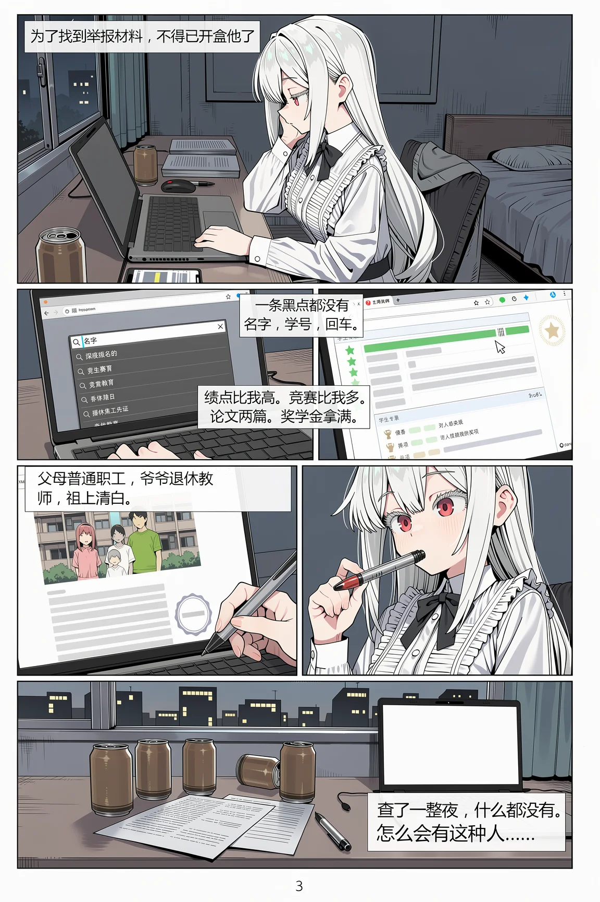

# 03 · 漫画分镜设计（一页七格 + 对白框 · 用 Scene JSON 排版）



**这是什么**：**一整页日式漫画**——顶部宽格、中间左右两格、下部左右两格、底部宽格，共 7 个分镜，外加 6 个对白框和 1 个页码，全部由 MOSS 一次性排版生成。
本库第三份案例，重点不是画功，而是**「页 → 格 → 框 → 字」四级定位怎么写**。

归档日期：2026-10-28 ｜ 本机实测：**1152×1728**，14 个元素，一次出图。

## ① 生成参数

| 项 | 值 |
|---|---|
| 底模 | `moss_image_base_int8_convrot.safetensors` |
| 文本编码器 | `qwen3.5_9b_int8_convrot.safetensors` |
| VAE | `flux2-vae.safetensors` |
| 加速 LoRA | `lodestones-8-steps-dmd2-lora`（strength 1） |
| 步数 / CFG | **8 / 1.0** |
| 采样器 / 调度 | `er_sde` / `simple` |
| 尺寸 | **1152 × 1728**（2:3，标准单页漫画比例） |
| Seed | `916870385206686` |
| 画质 LoRA | `moss_context_detailer_…rank2` 0.60 ＋ `LP Flat-moss-v2` 1.00 |
| 提示词 | Scene JSON，**9,989 字符**，14 个 elements |

## ② 结构：页 / 格 / 框 三级

| 层 | 元素 | 作用 |
|---|---|---|
| 页 | 整张稿纸（panel/background） | 暖白纸、黑色外框、内页边距 |
| 格 | 7 个 panel（obj/*） | 顶部宽格（宿舍夜）、中左（搜索页插入）、中右（成绩页插入）、下左（家庭资料页）、下右（脸部特写）、底部宽格（桌面空镜） |
| 框 | 6 个 text 元素 | 每框自带 `bbox` + `text` 原文，位置对齐各自那一格的留白 |
| 尾 | 页码 `3` | 右下角极小字号，单独一个 text 元素 |

**关键机制**：对白不是"画上去的字"，而是 `type: "text"` 的元素，带两个字段——
`bbox`（框在哪）和 `text`（写什么）。模型按框排字、按格留白，**不会把字压到脸上**。

## ③ 这一页的六个对白（原文）

| # | 位置 | 原文 |
|---|---|---|
| 1 | 顶部宽格左上 | 为了找到举报材料，不得已开盒他了 |
| 2 | 中左格 | 名字，学号，回车。 |
| 3 | 中右格 | 绩点比我高。竞赛比我多。论文两篇。奖学金拿满。 |
| 4 | 下左格 | 父母普通职工，爷爷退休教师，祖上清白。 |
| 5 | 下右格 | 一条黑点都没有。 |
| 6 | 底部宽格 | 查了一整夜，什么都没有。怎么会有这种人…… |

## ④ 复刻要点（换故事即可复用）

1. **先定页，再切格**：page 元素一条铺满；随后每个 panel 一条，用 bbox 切——**格与格之间留 4–8 单位空隙**，空隙就是装订线与呼吸感。
2. **每个 panel 的 identity 写三件事**：机位（wide shot / close insert / close-up）、场景、人物动作。别在一格里塞两个事件。
3. **对白框要单独成元素**（`type: "text"`），并且：
   - 框用**半透明米白**，不要纯白不透明（原文特意写 `never solid opaque white`）；
   - 框的 bbox 落在**格子内的留白区**，不压脸、不压关键道具；
   - `text` 字段写最终要出现的字，标点也照写。
4. **文字长度决定框高**：一句话 12–18 字最稳；超过 24 字就拆成两框或换行，硬塞会糊或溢出。
5. **特写格用来放情绪**：本页下右就是一张只打显示器冷光的脸——分镜的节奏靠"远景格 / 信息格 / 特写格"交替。
6. **页码这种极小元素也要单独给框**，否则模型会把"3"乱丢。
7. **黑白漫画不需要风格 LoRA**，靠 `LP Flat-moss-v2` 压平色块 + 描述里的网点/描线即可；换成彩色条漫再加风格 LoRA。

## ⑤ 提示词原文（Scene JSON，逐字未改）

```json
{
  "scene_type": "all-ages manga page, night dorm room, a girl digging up everything about a classmate and finding nothing",
  "gen_brief": "ONE finished manga page, not a collage: a single vertical sheet of warm off-white paper with a thin black outer border, ruled into panels by crisp DOUBLE-LINE gutters (two parallel black rules with a narrow white gap, printed-manga style). Packed layout, edge to edge, no dead white space: one wide panel across the top, a two-by-two block of panels in the middle, one wide panel across the bottom. Night interior of a small dormitory room, the only light sources a cold monitor glow and, in the last panel, the first grey of dawn. Flat cel-shaded manga colour, bold even black linework, one hard shadow tone per shape, no gradients on skin, palette of cold blue-grey shadows, warm ivory highlights and dead black. No speech balloons, no sound effects, no lettering inside the picture artwork; the only words are in the translucent caption panels described as text elements, all inside the page.",
  "elements": [
    {
      "type": "panel",
      "salience": "background",
      "identity": "The page itself: one vertical sheet of warm off-white manga paper, thin continuous black outer border, double-line panel gutters of two parallel black rules with a narrow white gap, meeting at clean right angles, packed edge to edge with panels.",
      "bbox": [
        -560,
        -848,
        560,
        848
      ]
    },
    {
      "type": "obj",
      "salience": "primary",
      "identity": "The wide top panel: a cramped student dormitory room at one in the morning, lights off. Serena, a stunning young maiden with snow-white hair and vivid crimson eyes, her side braids neatly tied with red strings and the rest of her hair flowing down to her waist, wearing a white long-sleeved vertically striped summer shirt with a gradient of black ribbon bows from large to small down her collarbone to her ribs, a fluffy ruffled frill on the right chest, a high-waisted pleated skirt in black and white checkerboard, classic Mary Jane shoes and thick black pantyhose sits at a cluttered desk seen from the side, leaning in on one elbow, cheek propped on her hand, staring at the monitor. The screen throws a hard cold white key light across her face and chest, leaving the rest of the room in blue-black; her snow-white hair catches the edge of the glow. The desk is crowded: a laptop with its screen turned away from the viewer, a stack of printed A4 sheets, a can of coffee, two more empty cans, a pen lying at an angle, a phone face-up with a dim notification. Behind her a folding chair with a jacket over it, a narrow bed, a window with the city night reduced to a few dim window squares. Her braid has slipped forward over her shoulder.",
      "bbox": [
        -560,
        -848,
        560,
        -380
      ]
    },
    {
      "type": "obj",
      "salience": "secondary",
      "identity": "The middle-left panel, a close insert of the laptop screen: a plain search engine page on a dark browser theme, one long empty search field with a blinking caret at its left end, and inside the field a name just typed in Simplified Chinese characters, still underlined as an active input; below it a short dropdown list of suggestion rows reduced to grey bands with no readable words. A fingertip rests on the trackpad in the lower foreground, the white striped cuff at the edge of frame. Everything except the typed name is deliberately unreadable.",
      "bbox": [
        -560,
        -364,
        -20,
        40
      ]
    },
    {
      "type": "obj",
      "salience": "secondary",
      "identity": "The middle-right panel, a close insert of a second screen: an academic record page built from ruled tables, and every cell of text reduced to soft grey bands so nothing is legible. The readable signals are graphic: one column of small green star glyphs running down the margin, a horizontal bar filled far past the others, two badge-shaped seals beside it, and a short list of award rows marked with tiny trophy icons. A cursor arrow sits over the top row. Cool screen light, faint scanlines.",
      "bbox": [
        4,
        -364,
        560,
        40
      ]
    },
    {
      "type": "obj",
      "salience": "secondary",
      "identity": "The lower-left panel, a third screen: a plain page showing one family photograph at the top, three small figures standing in front of an ordinary low-rise apartment block, their faces far too small to make out, the adults in plain everyday clothes and a thin young person between them; under the photo, five short grey data rows that are completely unreadable, and a small round stamp-shaped smudge. One corner of the monitor bezel and a strand of snow-white hair cross the frame.",
      "bbox": [
        -560,
        56,
        -20,
        460
      ]
    },
    {
      "type": "obj",
      "salience": "primary",
      "identity": "The lower-right panel, a close-up of her face lit only by the monitor: Serena, a stunning young maiden with snow-white hair and vivid crimson eyes, her side braids neatly tied with red strings and the rest of her hair flowing down to her waist, wearing a white long-sleeved vertically striped summer shirt with a gradient of black ribbon bows from large to small down her collarbone to her ribs, a fluffy ruffled frill on the right chest, a high-waisted pleated skirt in black and white checkerboard, classic Mary Jane shoes and thick black pantyhose biting down on the cap of a pen, the pen angling out of the corner of her mouth, both crimson eyes wide and unfocused on something off-frame, brows slowly lifting, the hard calculating line of her mouth going slack, a crease of fatigue under one eye. The cold screen light rakes across her cheekbone and leaves the far side of her face in flat shadow.",
      "bbox": [
        4,
        56,
        560,
        460
      ]
    },
    {
      "type": "obj",
      "salience": "secondary",
      "identity": "The wide bottom panel: the same desk seen flat-on in the grey hour before dawn, no figure in frame. Four empty coffee cans stand in a row with one tipped over, a fan of printed A4 sheets covered in unreadable grey text lies scattered, a pen rolled to the desk edge, the laptop now shut. Through the window behind, the sky has gone from black to a flat pale grey and the city lights are dimming. Everything still and cold and exhausted, long flat shadows.",
      "bbox": [
        -560,
        476,
        560,
        848
      ]
    },
    {
      "type": "text",
      "salience": "primary",
      "text": "为了找到举报材料，不得已开盒他了",
      "identity": "A semi-transparent milky off-white caption panel (never solid opaque white), the manga artwork and its colours clearly readable through it, one thin black rule around the edge, crisp black sans-serif Simplified Chinese with even tracking and comfortable margins, sitting over the dark upper part of the top panel, holding one line of Simplified Chinese.",
      "bbox": [
        -540,
        -840,
        -120,
        -744
      ]
    },
    {
      "type": "text",
      "salience": "secondary",
      "text": "名字，学号，回车。",
      "identity": "A semi-transparent milky off-white caption panel (never solid opaque white), the manga artwork and its colours clearly readable through it, one thin black rule around the edge, crisp black sans-serif Simplified Chinese with even tracking and comfortable margins, holding one short line of Simplified Chinese.",
      "bbox": [
        -540,
        -344,
        -60,
        -262
      ]
    },
    {
      "type": "text",
      "salience": "secondary",
      "text": "绩点比我高。竞赛比我多。论文两篇。奖学金拿满。",
      "identity": "A semi-transparent milky off-white caption panel (never solid opaque white), the manga artwork and its colours clearly readable through it, one thin black rule around the edge, crisp black sans-serif Simplified Chinese with even tracking and comfortable margins, holding two lines of Simplified Chinese.",
      "bbox": [
        24,
        -344,
        540,
        -238
      ]
    },
    {
      "type": "text",
      "salience": "secondary",
      "text": "父母普通职工，爷爷退休教师，祖上清白。",
      "identity": "A semi-transparent milky off-white caption panel (never solid opaque white), the manga artwork and its colours clearly readable through it, one thin black rule around the edge, crisp black sans-serif Simplified Chinese with even tracking and comfortable margins, holding two lines of Simplified Chinese.",
      "bbox": [
        -540,
        76,
        -60,
        196
      ]
    },
    {
      "type": "text",
      "salience": "secondary",
      "text": "一条黑点都没有。",
      "identity": "A semi-transparent milky off-white caption panel (never solid opaque white), the manga artwork and its colours clearly readable through it, one thin black rule around the edge, crisp black sans-serif Simplified Chinese with even tracking and comfortable margins, holding one short line of Simplified Chinese.",
      "bbox": [
        24,
        368,
        540,
        444
      ]
    },
    {
      "type": "text",
      "salience": "primary",
      "text": "查了一整夜，什么都没有。怎么会有这种人……",
      "identity": "A semi-transparent milky off-white caption panel (never solid opaque white), the manga artwork and its colours clearly readable through it, one thin black rule around the edge, crisp black sans-serif Simplified Chinese with even tracking and comfortable margins, holding three lines of Simplified Chinese, slightly larger than the small captions.",
      "bbox": [
        -540,
        600,
        -40,
        840
      ]
    },
    {
      "type": "text",
      "salience": "secondary",
      "text": "3",
      "identity": "A tiny plain black page numeral in a light sans-serif, alone on the pale desk surface, unobtrusive.",
      "bbox": [
        500,
        790,
        556,
        844
      ]
    }
  ],
  "bbox_coord_space": "abs_centralized"
}
```
