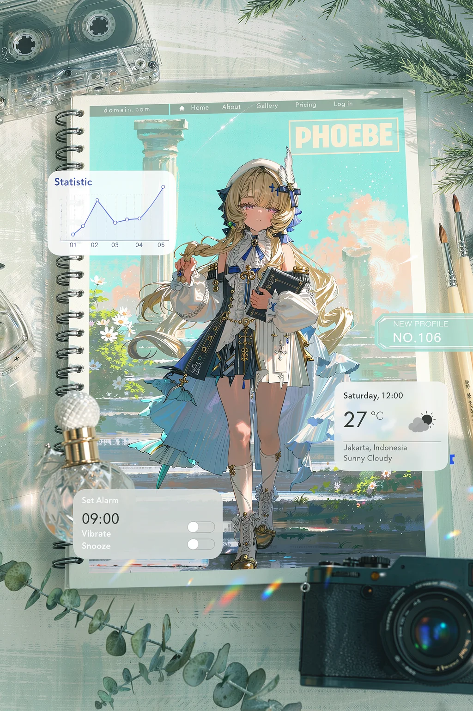

# 04 · 混合媒介拼贴人设图（实拍桌面 + 螺旋画册 + 页内网页 UI）



**这是什么**：一张竖版混合媒介编辑拼贴——真实桌面（透明磁带、香水瓶、相机、尤加利、白羽毛）压着一本斜放的螺旋装订画册，画册那一页是一张「角色资料网站」：顶栏导航 + 大海报标题 + 海边立绘，页面上还浮着四张 UI 卡片（统计折线图 / NEW PROFILE / 天气 / 闹钟），全部一次出图。

本库第四份案例，重点不在画功，而在两件事：**两层写实度怎么并置**（页面里的动漫立绘 vs 页面外的写实静物），和**界面上的文字怎么钉死**。

归档日期：2026-11-18 ｜ 本机实测：**1024 × 1536**，一次出图。

## ① 生成参数（从成图 PNG 元数据读出，非估计）

| 项 | 值 |
|---|---|
| 底模 | `moss_image_base_int8_convrot.safetensors` |
| 文本编码器 | `qwen3.5_9b_int8_convrot.safetensors`（type=`moss_image`） |
| VAE | `flux2-vae.safetensors` |
| 加速 LoRA | `lodestones-8-steps-dmd2-lora`（LoraLoaderModelOnly，strength 1.0） |
| 步数 / CFG | **8 / 1.0** |
| 采样器 / 调度 | `er_sde` / `simple` |
| 尺寸 | **1024 × 1536**（2:3） |
| Seed | `159232335616531` |
| 实际生效的 LoRA（3 条） | `moss-masterpieces-moss-timestep` 1.0 ＋ `moss_context_detaile_tweaker_20261018_rank2` 0.60 ＋ `mossNai5E585B6E4B889.Ng66` 1.0 |
| 负向提示词 | `worst quality, bad anatomy, watermark, jpeg artifact` |
| 提示词 | 纯自然语言长 caption，**5,275 字符**（非 JSON，非 Layout） |

> 注：LoRA 堆里还挂着另外 9 条（`anireal_moss_lora_v1`、`kzmynon-moss-v1`、`Nyalia_moss_v1` … `LP Flat-moss-v2`、`KOOK-MOSS-SFT` 等），但**这次是关着的**。`LoraManager` 会把全部 12 条的名字写进触发词串，真正作用于画面的只有上表那 3 条——看别人的图推参数时别被那张长串骗了。

## ② 这套东西凭什么成立：两条独立的链路

**链路一 · 层序**（从最远到最近，提示词里也是这个顺序）：

```
暖白桌面底 → 斜放的螺旋画册（页边距/环扣）→ 页内网页图形（顶栏/大标题/海景）
           → 海边立绘 → 四张浮起来的 UI 卡片 → 前景静物（磁带/香水/尤加利/相机/羽毛）
```

关键在**两个「浮起来」的层次**：UI 卡片浮在页面上（带阴影、倾斜），静物浮在画册上（压边、被裁切）。这套图的一切空间感都靠这两层遮挡建立。

**链路二 · 写实度分层**。开头的画质串先把整图定性为插画（`highly_intricate_finished_drawn, write_realistically, true_to_life, 3d`），随后用一句把人物单独切开：

> `Only_the_character's_face_is_in_anime_style、but_their_body_is_in_realistic_style`

页面外的静物不用这句话，改用**材质词**撑（玻璃折射、纸的纤维、植物叶脉、相机磨砂握把）。两条线不能混用同一套词，否则要么整张变成贴纸拼贴，要么整张变成实拍照。

## ③ 界面上的文字（原文，逐字保留）

| 位置 | 原文 |
|---|---|
| 页面顶栏（斜向） | `domain.com` · `Home` · `About` · `Gallery` · `Pricing` · `Log in` |
| 右上大标题 | `PHOEBE` |
| 左上统计卡 | `Statistic`；底部刻度 `01` `02` `03` `04` `05` |
| 右中铭牌 | `NEW PROFILE` / `NO.106` |
| 右下天气卡 | `Saturday, 12:00` / `27°C` / `Jakarta, Indonesia` / `Sunny Cloudy` |
| 左下闹钟卡 | `Set Alarm` / `09:00` / `Vibrate` / `Snooze` |

## ④ 复刻要点（换角色换主题即可复用）

1. **先写机位和载体，再写内容**：`high, slightly oblique overhead angle` ＋ 一本斜放（top edge rising toward the right）的螺旋画册。机位不定下来，后面每一层都会打架。
2. **页面当成网页来写**：先一条窄导航（含 6 个小字菜单），再大标题，然后「下面是插画」。网页的视觉层级就是提示词的段落顺序，倒过来就乱。
3. **四张卡片各自独立成段**：每段只写一张——位置、形状、透明度、投影、里面的文字。倾斜方向要交替（左上右倾、左下左倾），全同向会显得死板。
4. **文字加引号逐字写，数字也写**：`27°C`、`NO.106`、`09:00`、`01–05`、`domain.com` 都别留给模型猜。
5. **静物必须写「被画幅裁切」**：`cropped by the upper-left edges`、`cropped by the right and bottom edges`。不写这句，模型会把每个物件完整缩进去摆好，拼贴感立刻消失。
6. **真实物压 UI 要明写**：`A long soft white feather sweeps diagonally across the foreground and partly covers the alarm card`——这种「羽毛压闹钟卡」的遮挡是整张图的高级感来源。
7. **留一撮彩色光斑**：`rainbow refractions`、`small prismatic light streaks`。这点色散是「实拍」的证据，缺了就是纯扁平插画。
8. **人物全身可见且踩在页内台阶上**，鞋也要写进可见范围（`her entire figure, including her shoes, remains visible`）；否则模型会为省事裁掉脚。
9. 页内是海景（青绿水面、桃白云、残柱、藤蔓、小白花），页面外是暖白桌面 —— **冷暖两套色温分开写**，拼贴才会「一块是印的、一块是拍的」。

## ⑤ 提示词原文（逐字未改）

```text
, {The_image_is_highly_intricate_finished_drawn, write_realistically, true_to_life, 3d}, erotic skin texture, body blush, beautiful eyes, masterpiece, best quality, amazing quality, very aesthetic, very awa, absurdres, the picture has an alluring and erotic vibe, noline art, detailed eyes with glossy highlights, realistic PBR skin texture, realistic material rendering, Only_the_character's_face_is_in_anime_style、but_their_body_is_in_realistic_style, , A vertical mixed-media editorial collage viewed from a high, slightly oblique overhead angle, combining a detailed anime illustration with realistic glass, paper, foliage and camera materials. A large spiral-bound art notebook lies diagonally across a warm ivory tabletop, its top edge rising toward the right. Pale mint and white borders surround the page, and dark metal binding rings run down the left edge. The palette is seafoam green, pale aqua, cream, muted sage and deep teal, with navy and gold details on the character. Soft sunlight, delicate leaf shadows, glass reflections and scattered rainbow refractions give the whole composition a luminous, airy atmosphere.
The notebook page resembles a character-profile website. A narrow dark desaturated green navigation strip runs along the tilted top edge, with small white lettering reading from left to right: "domain.com", "Home", "About", "Gallery", "Pricing", "Log in". Just below it on the upper right, "PHOEBE" appears in very large, bold, condensed cream capitals inside a thin cream rectangular outline, following the same tilt. Beneath these graphic elements is a bright seaside illustration: turquoise water with fine sunlit ripples, a pale blue sky with billowing peach and cream clouds, weathered green-gray stone columns and steps, dense leafy vines, and clusters of small white flowers along the left side.
One full-body anime female character stands on the illustrated steps in the lower middle of the notebook, slightly right of the overall center. Her entire figure, including her shoes, remains visible. She has fair skin, long golden-blonde hair with bangs, slender braids framing her face and loose wavy lengths, warm pink-violet eyes, a small navy cross-shaped hair clip, and a gentle, composed expression directed toward the viewer. She wears a broad-brimmed ivory hat with navy ribbon and a small pale feather ornament. Her ornate white and dark navy outfit has a high collar, a blue ribbon and gold clasp at the neck, wide white sleeves, a short pleated skirt, gold edging, delicate filigree and cross motifs, and long blue-lined cape panels hanging behind her legs. White knee-high socks and ivory-and-gold shoes complete the outfit. The hand on the viewer's left lightly holds a braid near her shoulder; the hand on the viewer's right holds a dark, gold-decorated book upright against her torso.
Four layered interface elements float over the notebook, each casting a subtle shadow. At upper left, a tilted opaque white rounded statistics card overlaps the flowers and binding. The heading reads "Statistic" in dark blue. Below it is a navy line graph with six round data markers, a translucent pale blue-gray area fill and fine vertical guide lines; the line rises sharply, briefly levels off, dips slightly, then climbs to its highest point at the right. Five small labels along the bottom read "01", "02", "03", "04", "05". At middle right, a partly cropped translucent seafoam plaque with clipped corners and a fine double border reads "NEW PROFILE" above "NO.106" in white uppercase lettering. At lower right, a tilted pale frosted-glass weather card with rounded corners contains "Saturday, 12:00", a large "27°C", a dark sun-behind-cloud icon, "Jakarta, Indonesia", and "Sunny Cloudy". At lower left, a translucent sage alarm card tilts in the opposite direction, with white text reading "Set Alarm", a large "09:00", "Vibrate", and "Snooze", accompanied by three pale pill-shaped switches with white circular knobs on the right.
Tactile still-life objects frame and overlap the notebook. A large transparent audio cassette is cropped by the upper-left edges, showing two dark green tape reels, white hubs, tiny screws, clear molded plastic and a small pale "90" marking. Feathery evergreen branches fill the upper-right corner, beside a few slim paintbrushes with cream bristles and ivory art supplies cropped along the right edge. A faceted clear perfume bottle with a gold neck and a large white woven-texture spherical stopper overlaps the notebook at lower left; smaller pale glass objects are partly cropped along the left edge. A long soft white feather sweeps diagonally across the foreground and partly covers the alarm card. Dusty green eucalyptus stems with rounded leaves cross the lower-left and bottom edges. A large dark teal camera occupies the lower-right foreground, partly cropped by the right and bottom edges, with a textured grip and a prominent circular lens reflecting blue, green and gold light. Preserve the layered overlaps, gently tilted cards, delicate contact shadows and small prismatic light streaks, with a clear distinction between the anime figure inside the page and the realistic tabletop objects around it.
<lora:Lzzyv1.2_c1-st10000_fixed:0.8> <lora:SKP_MOS_Dv1:0.7> <lora:Moss-nai5-其三:0.6>
```
